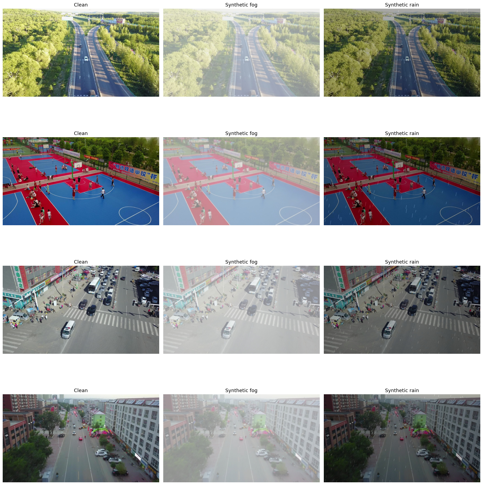

# Shift-Aware UAV Perception

A preliminary object-detection baseline for research on **shift-aware onboard perception and risk-adaptive safe flight for low-altitude delivery drones**.

> Project status: preliminary implementation developed during the research-proposal stage. This repository does not claim to implement the full test-time adaptation or flight-planning system.

## Motivation

Low-altitude delivery drones rely on onboard perception to detect surrounding objects. However, a detector trained in a clear-weather source domain may become unreliable after deployment under weather, visibility, altitude, or sensor-distribution shifts.

This project investigates the following research question:

> How can an edge-deployed UAV perception system detect its own performance degradation without target-domain labels, recover performance when possible, and provide risk-aware confidence signals for downstream flight decisions?

The current repository establishes a reproducible source-domain object-detection baseline. Future work will extend it with online perception-failure monitoring, selective test-time adaptation, and risk-aware flight degradation.

## Current Baseline

- **Detector:** YOLO11n
- **Source dataset:** [VisDrone2019-DET](https://github.com/VisDrone/VisDrone-Dataset)
- **Task:** 10-class aerial object detection
- **Training setup:** 50 epochs, image size 640, batch size 16, NVIDIA RTX 3090
- **Framework:** [Ultralytics YOLO](https://docs.ultralytics.com/)

The VisDrone dataset itself is not included in this repository. Please download it from the official source and prepare it in YOLO format before training.

## Preliminary Results

#### Controlled Weather-Shift Preview

The figure below shows the controlled synthetic visual shifts used only for an early pipeline stress test. These transformations are **not** presented as real-world weather data or as a final adverse-weather benchmark.



The source-trained detector was evaluated under a controlled visual-shift stress test.

| Condition | Precision | Recall | mAP@50 | mAP@50:95 | Comparison|
|---|---:|---:|---:|---:|---:|
| Clean | 0.4318 | 0.3178 | 0.2956 | 0.1667 | - |
| Synthetic fog | 0.3672 | 0.2614 | 0.2279 | 0.1280 | ⬇️ 22.9% |
| Synthetic heavy rain | 0.2219 | 0.1034 | 0.0669 | 0.0294 | ⬇️ 77.4% |

These results illustrate that a åsource-trained lightweight detector can degrade substantially under visual distribution shifts.

**Important limitation:** the fog and rain transformations are simple synthetic stress tests rather than real-world weather benchmarks. They are included only to validate the experimental pipeline and motivate the proposed research problem. Future evaluation will use more realistic adverse-condition target-domain data.


## Repository Structure

```text
shift_aware_uav/
├── README.md
├── visdrone.yaml                 # Dataset configuration
├── notebooks/
│   └── baseline_training.ipynb   # Data checking, training, and evaluation
├── artifacts/
│   └── results.csv               # YOLO training log
└── .gitignore